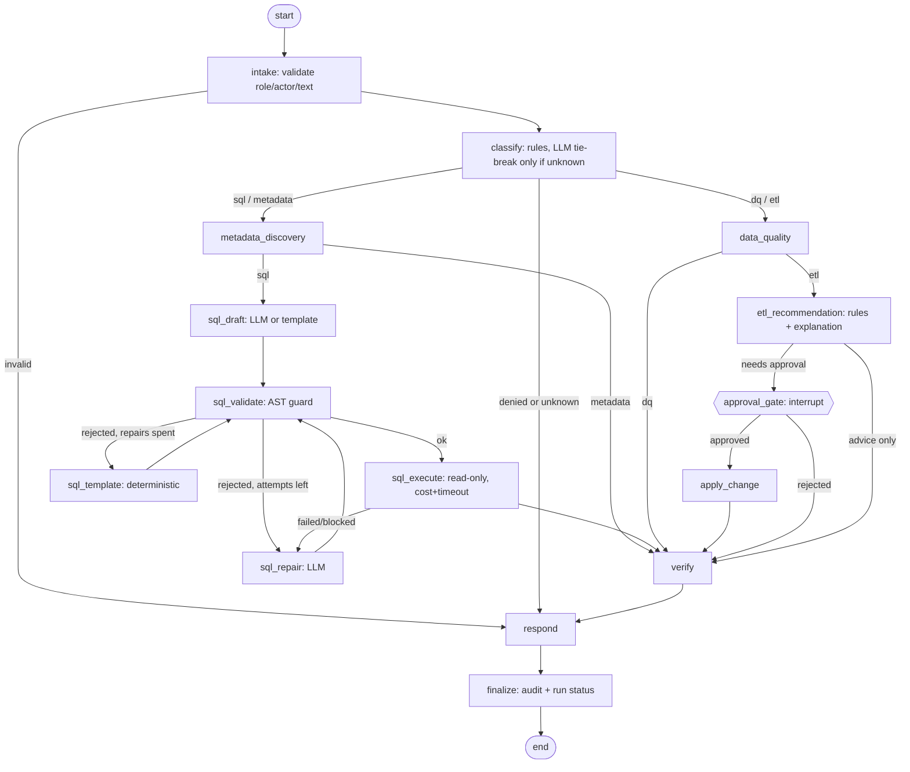

# Agent design (Phase 4)

One LangGraph workflow (`backend/app/agents/graph.py`), one typed shared state (`state.py`), Postgres checkpoints
(`app.checkpoints*`, created by LangGraph's `PostgresSaver` under the `app_rw` role), a user-visible run record
(`app.agent_runs`) and an audit trail (`app.audit_events`, insert-only).

| Agent | Responsibility | Inputs | Outputs | Tools it may call | Errors / hand-off |
|---|---|---|---|---|---|
| Router (not one of the four) | Pick the path | request text | intent, pipeline, run id | `llm_complete` (tie-break only) | unknown -> clarification; dq/etl as analyst -> denied |
| Metadata discovery | Find tables, columns, glossary terms the request is about | request, role | ranked hits, glossary, Gold schema permitted for the role | `catalog_search`, `dataset_columns`, `glossary_lookup`, `gold_schema` | no hit -> asks for clarification; hands context to SQL planner |
| SQL planner | Turn a business question into one safe, read-only query and run it | question, Gold schema context, role | executed SQL, rows (<=1000), query audit rows | `llm_complete`, `sql_validate`, `sql_execute` | guard rejection -> up to 2 repairs -> deterministic template -> refusal |
| Data quality | Summarise stored check results of a run | pipeline or run id | report: blocking failures, warnings, drift, reject reasons, `needs_etl` | `dq_latest_run`, `dq_results`, `dq_alerts`, `run_details` | missing pipeline -> asks which; for `etl` requests hands the report to the ETL agent |
| ETL recommendation | Diagnose a failed or drifting run and propose a fix | DQ report, run details | diagnosis, validated proposal, approval request | `dq_results`, `run_details`, `llm_complete` (explanation only), `create_approval` | proposal needing a change stops at `approval_gate`; advice-only proposals finish without approval |
| Approval executor (graph step) | Apply an approved change | approval id | before/after of the change | `apply_change` | refuses if not approved, tampered, invalid, or unknown |

Where each technique is used
- **Deterministic code:** authentication-independent role checks, tool allowlists, SQL guard (sqlglot AST), table/function
  allowlists, forced LIMIT, EXPLAIN cost cap, read-only role, statement timeout, intent routing rules, metadata search,
  DQ analysis, diagnosis rules, proposal validation and hashing, approval state machine, audit.
- **Traditional statistics:** PSI drift and volume checks (computed in the ETL, read by the DQ agent); Postgres full-text ranking.
- **LLM (Ollama, optional):** drafting and repairing SQL; phrasing the ETL explanation; breaking routing ties. Its output is text
  only and is always re-validated; it can never execute anything or change a proposal.
- **No LLM available:** SQL falls back to templates (a small set of common questions), explanations fall back to templates, routing
  falls back to `unknown`. Every fallback is recorded in `degraded_reasons` and shown to the user.

Safety properties tested (see `backend/tests/test_agent_*.py`, `test_sql_*.py`, `test_llm.py`)
- An agent cannot call a tool outside its allowlist; analysts cannot reach pipeline tools; denials are audited.
- No pipeline change happens before an engineer/admin approval is recorded; rejection changes nothing; decisions are single-use;
  a proposal edited after it was requested is refused (hash check); only allowlisted actions with bounded values can run.
- The graph pauses at the approval gate and resumes from the Postgres checkpoint with a brand-new process/connection.
- Generated SQL that is destructive, stacked, uses forbidden functions, other schemas or unauthorised tables never executes.

Known limits
- Caller identity (`--actor`, `--role`) is asserted, not authenticated, until the auth phase; the role checks themselves are in code.
- The template fallback answers only the question patterns in `sql_templates.py`; everything else is refused when no LLM is available.
- Real Ollama output quality (SQL accuracy of a 3B model) has not been measured; the adapter is tested against a fake server.
